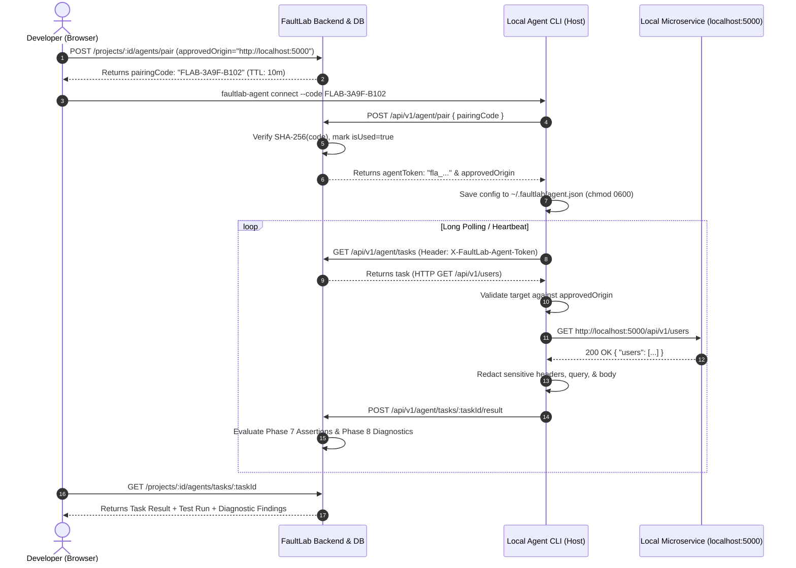

# FaultLab — Phase 9: Local Diagnostic Agent Architecture & Security Model

## 1. Overview & Purpose

The **FaultLab Local Diagnostic Agent** (`@faultlab/agent`) is a lightweight, secure background CLI worker that enables FaultLab's web platform to test and diagnose private backend APIs running on a developer's local machine (e.g. `http://localhost:5000` or `http://127.0.0.1:8080`) without requiring public tunnels, port forwarding, or inbound firewall openings.

---

## 2. Core Security Guarantees

### A. Zero Inbound Ports
The local agent never opens an HTTP or TCP listening socket on the host machine. All communications with the FaultLab backend occur via **outbound-only HTTPS polling**:
- Developer host initiates outbound requests to `https://<faultlab-backend>/api/v1/agent/*`.
- Developer machine attack surface remains strictly zero.

### B. Short-Lived Pairing Handshake
Agent onboarding utilizes a time-bounded, single-use pairing session:
1. **Initiation**: The project owner requests pairing in the UI, specifying the target `approvedOrigin` (e.g., `http://localhost:3000`).
2. **Code Generation**: A cryptographically random code (`FLAB-XXXX-YYYY`) is generated using `node:crypto`.
3. **Storage**: Only the **SHA-256 hash** of the pairing code is stored in the database (`AgentPairingSession`).
4. **Time-To-Live (TTL)**: Pairing codes expire automatically after **10 minutes**.
5. **Single-Use**: Once exchanged, the session is atomically marked `isUsed = true`. Subsequent attempts with the same code are rejected with HTTP 400.

### C. Revocable Agent Tokens
Upon successful code exchange:
- A high-entropy bearer token is issued (`fla_` followed by 64 hexadecimal characters / 256 bits of entropy).
- Only the **SHA-256 hash** (`tokenHash`) is persisted in the `LocalAgent` database record.
- If the token is compromised or no longer needed, the project owner can revoke it immediately via `DELETE /api/v1/projects/:projectId/agents/:agentId`.
- Revoked tokens result in an immediate HTTP 403 Forbidden on all subsequent polling and result submissions.

### D. Strict Target Origin Validation
Before executing any request enqueued by the server, the local agent enforces strict origin boundaries against the session's `approvedOrigin`:
- **Allowed Targets**: Must match the protocol, hostname, and port of `approvedOrigin`. Equivalence between `localhost` and `127.0.0.1` is normalized and supported.
- **SSRF / LAN Protection**: Disallowed origins (e.g., external domains, other local ports, private LAN IPs, cloud metadata IP `169.254.169.254`, IPv6 link-local `fe80::`, non-HTTP schemes `file://`, `ftp://`) are rejected locally with a `SecurityOriginError`.
- **No SSRF / Host Scanning**: The backend cannot instruct the agent to probe arbitrary internal hosts or cloud credentials.

### E. Secret & Sensitive Data Redaction
Before submitting execution evidence (headers, query parameters, bodies) back to FaultLab:
- **Headers Redacted**: `Authorization`, `Proxy-Authorization`, `Cookie`, `Set-Cookie`, `X-Api-Key`, `X-FaultLab-Agent-Token`.
- **Query Parameters Redacted**: `token`, `access_token`, `auth`, `key`, `api_key`, `secret`, `password`, `pwd`.
- **JSON Body Redaction**: Deep recursive key inspection replaces fields containing sensitive names (`password`, `secret`, `token`, `key`, `credit_card`, etc.) with `"[REDACTED]"`.

### F. Execution Guardrails
- **Max Response Size**: Capped at 1MB (`1,048,576 bytes`) to prevent memory exhaustion.
- **Execution Timeout**: Configurable timeout capped at 30 seconds (default 5000ms).
- **Redirect Isolation**: Redirects are followed with manual validation to prevent redirecting to forbidden host targets.

---

## 3. Architecture Sequence Diagram



---

## 4. CLI Command Reference

The agent CLI is distributed as `@faultlab/agent` (or via root workspace `npm run agent`):

### 1. Pair with FaultLab
```bash
faultlab-agent connect --code FLAB-XXXX-YYYY [--server <url>] [--name <device-name>]
```
Exchanges the single-use pairing code for a persistent token and saves credentials locally to `~/.faultlab/agent.json` (Unix permissions `0600`).

### 2. Start Polling Worker
```bash
faultlab-agent start [--interval <ms>] [--verbose]
```
Starts the background polling loop. Heartbeats are sent to the cloud backend every 30 seconds. Tasks are picked up, validated against the approved origin, executed locally, and reported back.

### 3. Inspect Agent Status
```bash
faultlab-agent status
```
Displays current agent ID, target approved origin, server URL, and local configuration path.

### 4. Disconnect & Clear Credentials
```bash
faultlab-agent disconnect
```
Notifies FaultLab that the agent is going OFFLINE and wipes `~/.faultlab/agent.json` securely from disk.

---

## 5. Multi-Tenant Isolation & Cascade Guarantees
- Local agents are strictly bound to a single `projectId`.
- Cross-tenant requests to enqueue tasks, inspect agent tasks, or trigger pairing sessions return HTTP 404.
- Deleting a `Project` cascades through Prisma relations (`onDelete: Cascade`), automatically pruning all associated `LocalAgent`, `AgentPairingSession`, and `AgentTask` records.

